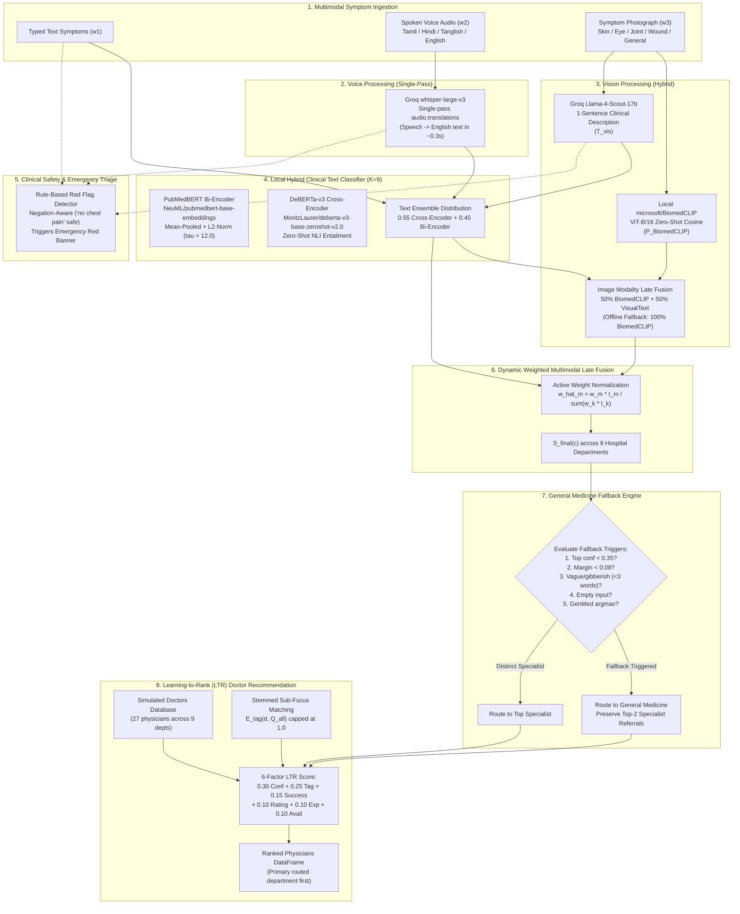

# 🏥 docDock: Multimodal Framework for Specialist Doctor Recommendation

[](https://www.python.org/)
[](https://opensource.org/licenses/MIT)
[]()

An end-to-end multimodal clinical decision-support and hospital department routing framework. Modeled after multispecialty hospital triage protocols (e.g., CMC Vellore), `docDock` ingests patient symptoms presented across **Text**, **Multilingual Spoken Voice** (Tamil, Hindi, Tanglish, Hinglish, English), and **Clinical Photography** (skin lesions, red eye, joint swelling, wounds) in any arbitrary combination. 

The system predicts one of **9 hospital departments** (8 organ-specific specialties plus **General Medicine / Internal Medicine**), executes automated emergency safety triage, applies a clinical fallback routing layer for ambiguous or non-specific symptoms, and ranks individual physicians using a 6-factor **Learning-to-Rank (LTR)** scoring model.

---

> [!WARNING]
> ### ⚠️ Mandatory Clinical Research & Administrative Disclaimer
> **`docDock` is an academic research prototype developed strictly for demonstration in the Stat-a-thon course.**  
> It is an administrative outpatient routing decision-support aid, **NOT** a medical diagnostic device. It does not provide medical advice, diagnosis, or clinical management plans.  
> **All doctor records in `DOCTORS_DB` are synthetic mock data** created for algorithmic evaluation and do not correspond to real medical personnel at CMC Vellore or elsewhere.  
> **If you are experiencing severe or life-threatening symptoms, immediately proceed to the nearest Hospital Emergency Department (Casualty) or dial emergency services (108 in India / 911 in North America).**

---

## 🏗️ System Architecture & Data Flow



---

## 🩺 The 9 Hospital Departments Supported

1. **General Dermatology & Cosmetology** (Rash, eczema, psoriasis, acne, vitiligo, hair loss, skin lesions)
2. **Cardiology & Cardiothoracic** (Chest tightness, palpitations, radiating pain, leg edema, hypertension)
3. **Orthopaedics & Rheumatology** (Joint pain, knee swelling, fractures, back stiffness, arthritis, sprain)
4. **Neurology & Neurosurgery** (Severe migraine, seizures, fits, numbness, facial palsy, tremors, stroke)
5. **Ophthalmology (Eye Care)** (Blurry vision, red eyes, conjunctivitis, cataract, double vision, glaucoma)
6. **Gastroenterology & Hepatology** (Acid reflux, abdominal cramps, jaundice, ulcers, heartburn, gastritis)
7. **Pulmonology (Respiratory Medicine)** (Chronic cough, wheezing, asthma, dyspnea, bronchitis, sputum)
8. **ENT (Otorhinolaryngology)** (Ear pain, discharge, sore throat, tonsillitis, sinus congestion, tinnitus)
9. **General Medicine (Internal Medicine)** (Fever, chills, body ache, fatigue, weakness, tiredness, loss of appetite, general malaise, cold, flu, viral infection, headache with fever, dizziness, dehydration, diabetes, thyroid, anaemia, routine check-up, multiple unrelated symptoms, unwell)

---

## 🛡️ General Medicine Fallback Routing Engine

To protect patients with vague, ambiguous, or multi-system symptoms from being misdirected to an incorrect sub-specialist, `docDock` enforces automated fallback routing to **General Medicine (Internal Medicine)**.

### Configurable Thresholds (`core/config.py`)
- `LOW_CONFIDENCE_THRESHOLD = 0.35`: If the top specialty probability is below 35%, symptoms are deemed too diffuse for a specialist.
- `AMBIGUITY_MARGIN = 0.08`: If the margin between the #1 and #2 specialties is below 8%, symptoms match multiple departments ambiguously.
- `MIN_MEANINGFUL_WORDS = 3`: If patient text contains fewer than 3 non-stopword clinical terms or is keyboard smash (e.g., `"asdf qwerty"`, `"I don't feel well"`).

### Fallback Reasons (`fallback_reason`)
| `fallback_reason` | Condition | Clinical Interpretation & Output |
|---|---|---|
| `no_input` | No inputs provided or all modality calls failed | Prompt patient to provide symptoms; routes to General Medicine for routine intake. |
| `vague_input` | Fewer than 3 meaningful words or gibberish | *"Your symptoms were not specific enough to pick a specialist, so we recommend starting with General Medicine, who can refer you onward."* |
| `general_is_top` | General Medicine is the natural argmax (e.g. fever + fatigue) | Primary General Medicine routing for systemic illness. |
| `low_confidence` | Top probability $< 0.35$ | Symptoms are diffuse across multiple specialties; routed to General Medicine with top-2 specialist referrals preserved. |
| `ambiguous` | Margin $(P_{(1)} - P_{(2)}) < 0.08$ | Symptoms match multiple organs closely; routed to General Medicine with top-2 specialist referrals preserved. |
| `none` | High confidence, distinct specialist match | Clean specialist routing (e.g., Dermatology or Gastroenterology). |

---

## 🔬 Mathematical Formulations

### 1. Hybrid Medical Text Engine ($P_{\text{HybridText}}$)
Given symptom text $T$ from typed text, transcribed speech, or synthesized visual description:
1. **Bi-Encoder Cosine Similarity (`NeuML/pubmedbert-base-embeddings`):**  
   Encodes symptom query $\mathbf{e}_T$ and precomputed department symptom profiles $\mathbf{e}_{D_c}$ into normalized 768-D vectors ($K=9$). With temperature scaling $\tau = 12.0$:
   $$P_{\text{BiEncoder}}(c \mid T) = \frac{\exp(\tau \cdot \cos(\mathbf{e}_T, \mathbf{e}_{D_c}))}{\sum_{j=1}^{9} \exp(\tau \cdot \cos(\mathbf{e}_T, \mathbf{e}_{D_j}))}$$
2. **Cross-Encoder Zero-Shot NLI (`MoritzLaurer/deberta-v3-base-zeroshot-v2.0`):**  
   Evaluates sentence-level entailment across hypothesis template *"This patient describes clinical symptoms treated by the {} department."* to yield $P_{\text{CrossEncoder}}(c \mid T)$. Catches conversational phrasing and negations (*"no chest pain"*).
3. **Late Fusion Combination:**
   $$P_{\text{HybridText}}(c \mid T) = 0.55 \cdot P_{\text{CrossEncoder}}(c \mid T) + 0.45 \cdot P_{\text{BiEncoder}}(c \mid T)$$

### 2. Hybrid Image Pipeline ($P_{\text{image}}$)
1. **Local BiomedCLIP (`microsoft/BiomedCLIP`):** Computes zero-shot ViT-B/16 visual probabilities across 9 pre-tokenized visual specialty prompts:
   $$P_{\text{BiomedCLIP}}(c \mid I) = \text{Softmax}\left(\lambda \cdot \mathbf{v}_{\text{ViT}}(I) \cdot \mathbf{t}_{\text{PubMedBERT}}(c)^T\right)$$
2. **Cloud Vision-to-Text (`llama-4-scout-17b-16e-instruct` $\rightarrow$ Hybrid Text Engine):** Generates 1-sentence clinical description $T_{\text{vis}}$ and calculates $P_{\text{VisualText}}(c \mid I) = P_{\text{HybridText}}(c \mid T_{\text{vis}})$.
3. **Image Combination (with offline fallback):**
   $$P_{\text{image}}(c) = \begin{cases} 
   0.50 \cdot P_{\text{BiomedCLIP}}(c \mid I) + 0.50 \cdot P_{\text{VisualText}}(c \mid I) & \text{if Vision API available} \\
   P_{\text{BiomedCLIP}}(c \mid I) & \text{if offline / fallback}
   \end{cases}$$

### 3. Dynamic Weighted Late Fusion ($S_{\text{final}}$)
Let $\mathbb{I}_{\text{text}}, \mathbb{I}_{\text{speech}}, \mathbb{I}_{\text{image}} \in \{0, 1\}$ denote whether the patient provided each modality. Active weights are dynamically normalized over supplied inputs only:
$$\hat{w}_m = \frac{w_m \cdot \mathbb{I}_m}{\sum_{k \in \{\text{text, speech, image}\}} w_k \cdot \mathbb{I}_k}, \quad S_{\text{final}}(c) = \sum_{m} \hat{w}_m P_m(c)$$

### 4. Learning-to-Rank (LTR) Doctor Score ($R_d$)
For each physician $d$ belonging to the routed department (or referral specialties):
$$R_d = 0.30 \cdot S_{\text{final}}(c_d) + 0.25 \cdot E_{\text{tag}}(d, Q_{\text{all}}) + 0.15 \cdot \text{success\_rate}_d + 0.10 \cdot \frac{\text{Rating}_d}{5.0} + 0.10 \cdot \min\left(\frac{\text{Exp}_d}{25}, 1.0\right) + 0.10 \cdot \text{Avail}_d$$
- $Q_{\text{all}} = T_{\text{text}} \cup T_{\text{speech}} \cup T_{\text{vis}}$ is the combined bag of symptom tokens.
- $E_{\text{tag}}(d, Q_{\text{all}})$ computes stemmed keyword overlap against doctor $d$'s sub-focus tags (strictly capped at 1.0).
- Scaled to $[0, 100]$: $\text{LTR\_Score} = \text{round}(R_d \times 100, 1)$.

---

## 🚀 Setup & Installation

### 1. Prerequisites
- macOS (Apple Silicon MPS / Intel) or Linux (CUDA / CPU)
- Python 3.10+ (tested on Python 3.13)
- Optional: Groq API Key from [console.groq.com](https://console.groq.com) for Whisper speech translation. (The app functions locally without Groq using PubMedBERT + DeBERTa + BiomedCLIP).

### 2. Environment Setup
```bash
# Clone the repository
git clone https://github.com/your-username/docDock.git
cd docDock

# Create virtual environment
python3 -m venv .venv
source .venv/bin/activate

# Install pinned dependencies
pip install -r requirements.txt
```

### 3. Configure Environment Variables
Copy `.env.example` to `.env`:
```bash
cp .env.example .env
```
Edit `.env`:
```env
# Groq API Key for Whisper audio translation & Llama-4-Scout Vision
GROQ_API_KEY=your_actual_groq_api_key_here

PORT=7860
HOST=127.0.0.1
```

### 4. Run the Application
```bash
python app.py
```
Open your browser to: **`http://127.0.0.1:7860`**

---

## 🧪 Verification & Pre-Loaded Demo Cases

Click any of the pre-loaded examples in the Gradio UI or run the automated test suite:

### 1. Spoken Tanglish Voice Only ($w_2 = 1.0$)
* **Spoken Input:** *"Doctor, enakku rendu naala skin-la romba itching and red patches irukku."*
* **Single-Pass Translation:** `whisper-large-v3` $\rightarrow$ *"Doctor, for two days I have severe itching and red patches on my skin."*
* **Routing:** Fused to **General Dermatology & Cosmetology** (`fallback_reason = "none"`).
* **Doctor Ranking #1:** **Dr. Aravind Swaminathan (Mock)** (LTR Score: `65.1`).

### 2. Text with Negation Nuance ($w_1 = 1.0$)
* **Typed Input:** *"My stomach burns after eating spicy food, I have acid reflux, no chest pain."*
* **Safety Triage:** Negation logic suppresses false alarm $\rightarrow$ Emergency triage **NOT** triggered.
* **Routing:** DeBERTa-v3 detects `"no chest pain"`, suppressing Cardiology to `2.4%` and routing to **Gastroenterology & Hepatology** (`81.4%`).
* **Doctor Ranking #1:** **Dr. Mohammed Farooq (Mock)** (LTR Score: `89.8`).

### 3. Multimodal Clinical Photo + Text ($w_1 = 1.0, w_3 = 1.0$)
* **Uploaded Photo:** Clinical image of erythematous skin rash (`sample_data/skin_rash.jpg`).
* **Typed Symptoms:** *"I have an itchy red rash and inflamed patches on my skin."*
* **Routing:** Fused to **General Dermatology & Cosmetology** (`fallback_reason = "none"`).
* **Doctor Ranking #1:** **Dr. Aravind Swaminathan (Mock)** (LTR Score: `83.0`).

### 4. General Medicine Primary Case ($w_1 = 1.0$)
* **Typed Input:** *"I have fever, body ache and feel very tired for 3 days."*
* **Routing:** **General Medicine (Internal Medicine)** (`fallback_reason = "general_is_top"`).
* **Doctor Ranking #1:** **Dr. Sundararajan Ramanathan (Mock)**.

### 5. Vague Input Fallback Case ($w_1 = 1.0$)
* **Typed Input:** *"I don't feel well."*
* **Fallback Trigger:** Meaningful words $< 3$ $\rightarrow$ `fallback_reason = "vague_input"`.
* **Routing:** **General Medicine (Internal Medicine)** with referral notes.
* **Doctor Ranking #1:** **Dr. Sundararajan Ramanathan (Mock)**.

### 6. Emergency Red Flag Case ($w_1 = 1.0$)
* **Typed Input:** *"Crushing chest pain spreading to my left arm and jaw."*
* **Safety Triage:** 🚨 **CRITICAL EMERGENCY ALERT** banner triggered immediately.
* **Routing:** Cardiology & Cardiothoracic (administrative recommendation alongside urgent casualty warning).

---

## 🛡️ Running Automated Tests

All 24 unit and integration tests run locally via pytest with network mocks:

```bash
pytest tests/ -v
```

Expected output:
```
============================= test session starts ==============================
tests/test_end_to_end.py::test_pipeline_end_to_end_multimodal PASSED     [  4%]
tests/test_end_to_end.py::test_pipeline_end_to_end_general_medicine_fallback PASSED [  8%]
tests/test_fusion.py::test_fusion_voice_only_normalization PASSED        [ 12%]
tests/test_fusion.py::test_fusion_all_zero_sliders_fallback PASSED       [ 16%]
tests/test_fusion.py::test_fallback_vague_input PASSED                   [ 20%]
tests/test_fusion.py::test_fallback_gibberish_and_empty PASSED           [ 25%]
tests/test_fusion.py::test_fallback_ambiguous_and_low_confidence PASSED  [ 29%]
tests/test_fusion.py::test_fallback_thresholds_tuning PASSED             [ 33%]
tests/test_fusion.py::test_dermatology_no_fallback_when_distinct PASSED  [ 37%]
tests/test_image_engine.py::test_image_missing_groq_key_biomedclip_fallback PASSED [ 41%]
tests/test_image_engine.py::test_image_groq_vision_mocked_fusion PASSED  [ 45%]
tests/test_ltr.py::test_ltr_scores_in_range_and_sorted_descending PASSED [ 50%]
tests/test_ltr.py::test_tag_overlap_stemming_and_cap PASSED              [ 54%]
tests/test_ltr.py::test_ltr_guarded_against_single_department PASSED     [ 58%]
tests/test_ltr.py::test_ltr_general_medicine_doctors_when_routed PASSED  [ 62%]
tests/test_text_engine.py::test_text_only_dermatology PASSED             [ 66%]
tests/test_text_engine.py::test_text_negation_gastroenterology PASSED    [ 70%]
tests/test_text_engine.py::test_text_general_medicine_fever PASSED       [ 75%]
tests/test_triage.py::test_triage_red_flag_triggered PASSED              [ 79%]
tests/test_triage.py::test_triage_negation_not_triggered PASSED          [ 83%]
tests/test_triage.py::test_triage_stroke_fast_triggered PASSED           [ 87%]
tests/test_triage.py::test_triage_clinical_denials_not_triggered PASSED  [ 91%]
tests/test_voice_engine.py::test_voice_tanglish_mocked_to_dermatology_and_aravind_swaminathan PASSED [ 95%]
tests/test_voice_engine.py::test_voice_missing_key_graceful_handling PASSED [100%]
======================== 24 passed in 23.99s ========================
```

---

## 📁 Repository Structure

```
docDock/
├── .env                      # Local environment configuration
├── .env.example              # Template for environment variables
├── requirements.txt          # Pinned dependency manifest
├── README.md                 # Complete documentation
├── app.py                    # Gradio interactive web application
├── core/
│   ├── __init__.py
│   ├── config.py             # Settings, thresholds (LOW_CONFIDENCE, AMBIGUITY), weights
│   ├── data.py               # 9 department profiles, visual prompts, mock doctor DB (27 docs)
│   ├── text_engine.py        # HybridMedicalTextClassifier (PubMedBERT + DeBERTa-v3)
│   ├── voice_engine.py       # Single-pass Groq Whisper speech translation
│   ├── image_engine.py       # HybridMedicalImageAnalyzer (BiomedCLIP + Llama-4-Scout)
│   ├── triage.py             # Rule-based red-flag triage with clause negation logic
│   ├── fusion.py             # Dynamic weighted late fusion + General Medicine Fallback Engine
│   └── ltr.py                # 6-factor LTR doctor ranking & stemmed tag matching
├── sample_data/
│   ├── skin_rash.jpg         # Sample clinical lesion image
│   ├── red_eye.jpg           # Sample conjunctival injection image
│   └── tanglish_dermatology_symptom.wav  # Sample audio asset
└── tests/
    ├── __init__.py
    ├── conftest.py           # Session fixtures & preloaded models
    ├── test_text_engine.py   # Text semantic routing & negation tests
    ├── test_triage.py        # Red-flag & negation tests
    ├── test_fusion.py        # Fusion weights & fallback trigger tests
    ├── test_voice_engine.py  # Audio translation & Groq mocking tests
    ├── test_image_engine.py  # BiomedCLIP & Vision API fallback tests
    ├── test_ltr.py           # Doctor ranking, General Medicine ranking, & bounds tests
    └── test_end_to_end.py    # Full pipeline multimodal & fallback integration tests
```
